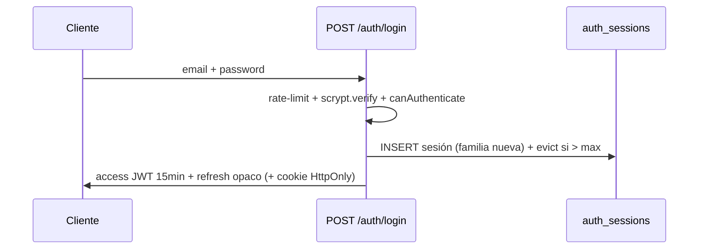
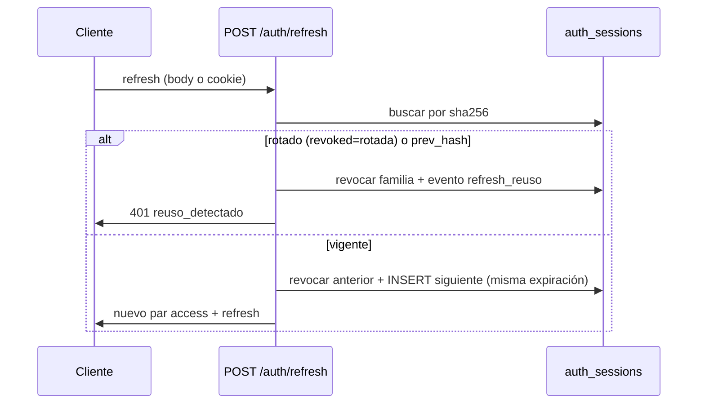

# AUTHENTICATION_AND_SESSIONS.md — flujos reales (Fase B)

## Endpoints

| Método | Ruta | Auth | Notas |
|---|---|---|---|
| POST | `/auth/register` | no | 201 siempre igual (anti-enumeración); rate 5/h/IP |
| POST | `/auth/login` | no | access+refresh en cuerpo + cookie `lex_refresh`; rate 10/min/IP |
| POST | `/auth/refresh` | refresh | body o cookie; rota; reúso → 401 + revoca familia |
| POST | `/auth/logout` | refresh opcional | idempotente; limpia cookie |
| POST | `/auth/logout-all` | Bearer | revoca todo; responde conteo |
| POST | `/auth/verify-email` | no | token 24h, un uso |
| POST | `/auth/resend-verification` | no | idéntico exista o no; rate 5/h/IP |
| POST | `/auth/forgot-password` | no | idéntico exista o no; token 1h; rate 5/h/IP |
| POST | `/auth/reset-password` | token | revoca todas las sesiones |
| POST | `/auth/change-password` | Bearer | exige actual (re-auth); revoca las demás |
| GET | `/auth/sessions` | Bearer | activas, con flag `current` |
| DELETE | `/auth/sessions/:id` | Bearer | 404 idéntico ajena/inexistente |
| GET | `/account/me` | Bearer | perfil público (sin hash ni internos) |

POSTs → 201 (default Nest, igual que `/agent/investigate` existente).

## Flujos (Mermaid)

## Sesión: expiración e invalidación

- Absoluta: `expires_at` (30 días, conservada al rotar). Inactividad: 7 días
  sin `last_seen` (configurables: `AUTH_REFRESH_TTL_DAYS`, `AUTH_INACTIVITY_DAYS`).
- Se invalidan todas ante: reset-password, cambio de e-mail (Fase G),
  activación/desactivación 2FA (Fase C), bloqueo admin, borrado (cascada).
- Cambio de contraseña: revoca todas **excepto** la actual.
- Límite concurrente: `AUTH_MAX_SESSIONS=10`, evict oldest-first (política
  visible, documentada en el mensaje de login — sin sorpresas).

## Tokens y cookies

- Access: JWT HS256 `{sub, sid, role, iat, exp}`, secreto `AUTH_JWT_SECRET`
  (dev default + warn; prod obligatorio ≥32 chars). Guard verifica firma,
  exp/iat **y** sesión activa en DB.
- Refresh: 32 bytes base64url; en DB solo `sha256`. Nunca en logs
  (verificado: logs solo registran eventos sin tokens).
- Cookie `lex_refresh`: `HttpOnly`, `SameSite=Lax`, `Path=/auth`,
  `Secure` por config (false local). CSRF: Lax bloquea POST cross-site;
  clientes no-web usan el cuerpo JSON.

## Anti-abuso y auditoría

- Registro/login/recuperación con mensajes uniformes + hash dummy en login
  de usuario inexistente (timing). Contraseñas: scrypt, rehash transparente.
- `security_events`: register/login/verify/reset/change/logout/revocaciones/reúso
  (sin secretos ni contenido privado). Retención: 1 año (Fase H: job purga).
