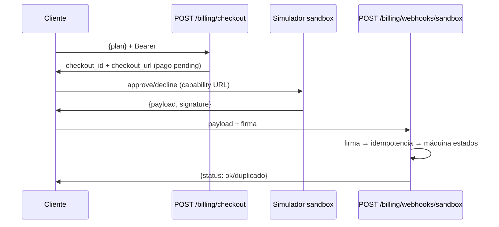

# PAYMENT_INTEGRATION.md — pagos sandbox + Wompi futuro (Fase F)

## Estado explícito

✅ Checkout sandbox punta a punta (firmado, idempotente, auditado).
⏳ Proveedor real (Wompi): adaptador pendiente de credenciales y validación.
No se ejecutaron cobros ni reembolsos reales. Precios = ejemplos sandbox.

## Arquitectura

Puerto `PaymentProvider` (dominio-agnóstico): `createCheckout`,
`verifyWebhook`, `parseEvent`. `SandboxPaymentProvider` lo implementa con
HMAC-SHA256 propio (header `x-sandbox-signature`, NO la firma Wompi).
El adaptador Wompi futuro implementa el mismo puerto; casos de uso intactos.

## Máquina de estados (código: `TRANSITIONS`)

`trialing → active|canceled|expired`; `active → past_due|canceled|expired`;
`past_due → active|canceled|expired`; terminales sin salida.
Pagos: `pending → succeeded|failed`; `succeeded → refunded`.
`succeeded` gana a `failed` tardío; duplicados por `(provider, event_id)`.

## Reglas de seguridad verificadas

- Firma sobre cuerpo crudo (`rawBody`, tope 1MB); manipulación → 401.
- Monto/moneda/user/plan del evento vs. cobro pendiente (mismatch → failed).
- Suscripción solo por webhook verificado, nunca por retorno de checkout.
- Cero datos de tarjeta en tablas, payloads y logs (auditado en DB).
- Reembolso mantiene acceso hasta fin de periodo (documentado, no corte).

## Endpoints

`POST /billing/checkout`, `POST /billing/webhooks/:provider`,
`POST /billing/subscription/cancel|resume|change-plan`,
`GET /billing/payments|subscription/history`,
`GET|POST /billing/sandbox/checkouts/:id[/approve|/decline]` (403 si no sandbox).

## Wompi (pendiente, investigado 2026-10-27)

Fuentes: [sandbox y llaves](https://docs.wompi.co/en/docs/panama/ambientes-y-llaves/),
[eventos webhook](https://docs.wompi.co/en/docs/panama/eventos/),
[sandbox Colombia](https://docs.wompi.co/en/docs/colombia/datos-de-prueba-en-sandbox/).
Verificado: ambiente sandbox separado, webhooks POST JSON, tokenización para
cobros repetidos. NO verificado (releer docs al implementar): nombre exacto del
header de firma de eventos y producto nativo de suscripciones recurrentes —
por eso el motor de suscripciones es nuestro y el proveedor solo cobra.
Adaptador Wompi: verificar firma oficial, mapear `transaction.updated` →
`payment.succeeded/failed`, sandbox primero, credenciales en KMS/env.

## Deuda

- `webhook_events.payload` conserva `user_id` tras borrado de cuenta →
  anononimizar en Fase G (borrado).
- Sin dunning programado (past_due manual) ni prorrata en change-plan.
- `cancel_at_period_end`→`expired` requiere job o evaluación lazy (Fase H).
