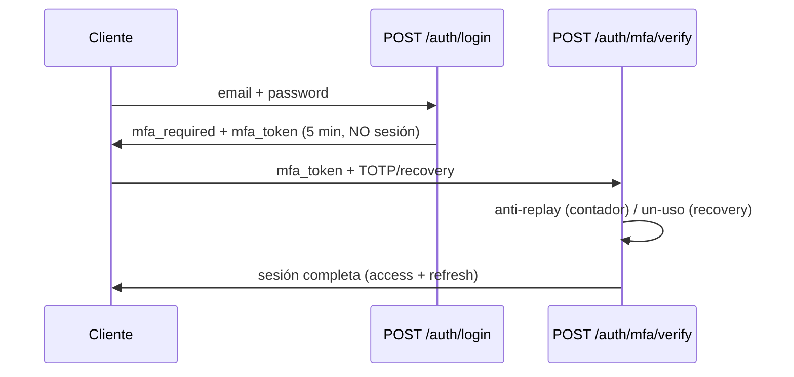

# TOTP_AND_RECOVERY.md — 2FA real (Fase C)

## Endpoints

| Método | Ruta | Auth | Notas |
|---|---|---|---|
| POST | `/auth/mfa/verify` | mfa_token | TOTP o recovery → sesión completa + cookie |
| GET | `/account/security/totp/status` | Bearer | `{status, recovery_codes_left}` (nunca el secreto) |
| POST | `/account/security/totp/setup` | Bearer | `otpauth_url` (única muestra del secreto) |
| POST | `/account/security/totp/confirm` | Bearer | activa + 10 recovery (única muestra) |
| POST | `/account/security/totp/disable` | Bearer + password + factor | borra config y códigos |
| POST | `/account/security/totp/recovery-codes/regenerate` | Bearer + password + factor | invalida anteriores |

## Flujo

## Seguridad

- TOTP RFC 6238 verificado contra vectores oficiales (unitarias).
  Ventana ±1 paso (30s), configurable `TOTP_WINDOW`.
- Anti-replay estricto: un código vale para **una sola operación**
  (`last_counter` en DB; confirm consume). Tras confirmar, el siguiente
  login usa el código siguiente.
- Secreto: 20 bytes aleatorios, AES-256-GCM (`v1.iv.ct+tag`), clave
  `TOTP_ENCRYPTION_KEY` (32 bytes hex) **externa a la DB**; dev default + warn.
  Formato versionado para rotación (re-cifrar con `v2` futuro).
- Recovery: 10 códigos `XXXX-XXXX` (40 bits), sha256 en DB, un uso
  (`markUsed` atómico anti-doble-uso), regenerables (invalidan anteriores).
- Rate: MFA 10/5min por IP; operaciones TOTP 20/h por usuario.
- Sesiones: confirm/disable revocan las demás (`totp_activado/desactivado`).
- Claves separadas (§14): firma access ≠ firma MFA (derivación HMAC
  `lex-mfa-v1`) ≠ cifrado TOTP ≠ hash scrypt ≠ sha256 tokens opacos.
- Sin 2FA disponible y sin recovery → desbloqueo solo por admin (Fase D).
- Secretos/códigos jamás en logs ni en `status`/`me` (humo lo asserts).
