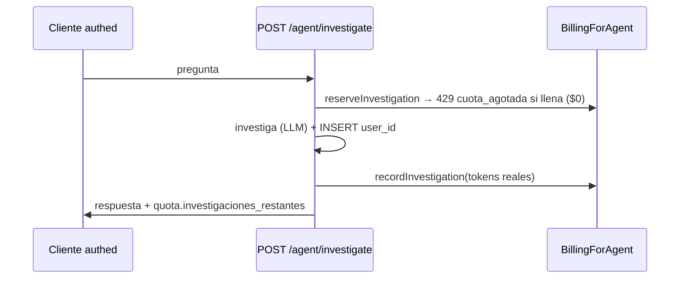

# USAGE_METERING.md — medición centralizada (Fase E)

## Modelo

- `usage_events`: append-only idempotente (`idempotency_key` único). Kinds:
  `investigacion` (reserva pre-vuelo, units=1), `investigacion_tokens`
  (post-vuelo, tokens reales, clave `inv:{id}:tokens`), `verificacion`
  (juez por informe, clave única por generación — cada informe cuesta).
- `usage_periods`: contadores `(user_id, YYYY-MM)` para compuerta atómica.
- Sin contenido privado: solo usuario, kind, unidades, tokens, costo, refs.

## Atomicidad y concurrencia

- `consume()`: `INSERT` evento + `UPDATE ... WHERE inv+u<=cuota AND tok+t<=cuota`
  en una transacción. Duplicado → rollback + `duplicado`; sin cupo → rollback +
  causa exacta. Verificado: reserva fallida deja 0 eventos y contadores intactos.
- `record()`: inserción idempotente + suma sin compuerta (post-vuelo; el gasto
  ya ocurrió). Reintentos no duplican (verificado: 2 re-records → sin cambio).
- Doble cobro imposible por construcción: misma clave = mismo evento.

## Flujo agente (verificado con 1 investigación real, $0.03)

Anónimos: sin reserva ni registro (legacy). Juez (`GET /report/:id` con Bearer):
`recordVerification` post-vuelo, sin compuerta (barato, documentado).
