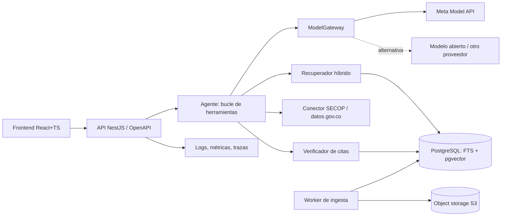

# SYSTEM_ARCHITECTURE — Arquitectura propuesta (monolito modular)

**Decisión provisional:** un solo backend modular + workers, no microservicios. Justificación: equipo pequeño, 10 días, costo bajo; los módulos quedan separados por interfaces para extraerlos después.

## Componentes
| Componente | Responsabilidad | MVP |
|---|---|---|
| ModelGateway | Interfaz única `chat`, `embed`, `rerank`; reintentos, conteo de tokens, límites de gasto, cambio de proveedor | Sí |
| Recuperador híbrido | BM25/FTS + vectorial, fusión (RRF), reranking opcional | Sí |
| Agente | Planifica, llama herramientas, limita pasos (máx. N) y costo; sin acciones externas con efectos | Sí |
| Conector SECOP | SoQL con caché y paginación; nunca vuelca registros masivos al contexto del LLM | Sí |
| Verificador de citas | Resuelve cada cita a un fragmento almacenado y comprueba que el texto citado exista | Sí |
| Ingesta | Descarga, extracción, fragmentación, indexación | Corpus semilla |
| Auth/Workspaces | Roles, aislamiento | No (posterior) |

## Principios
1. Los LLM **no** reciben tablas completas: el agente consulta con filtros y recibe agregados o pocas filas.
2. Todo texto externo se trata como dato no confiable (ver SECURITY.md, pendiente).
3. Redis/colas solo cuando haya trabajo asíncrono real (OCR, sincronización); en MVP basta un job runner dentro de PostgreSQL o proceso worker simple.

## Límites a documentar al medir
Memoria del índice vectorial, latencia por paso del agente, costo por investigación (objetivo a medir, no asumido).
